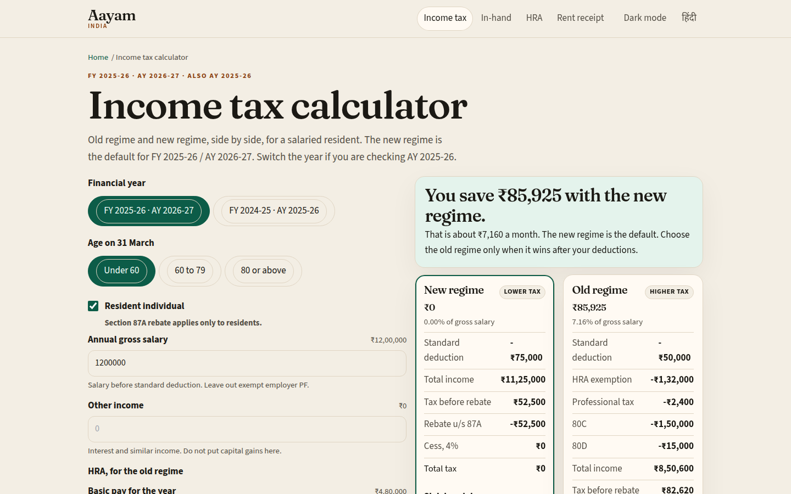
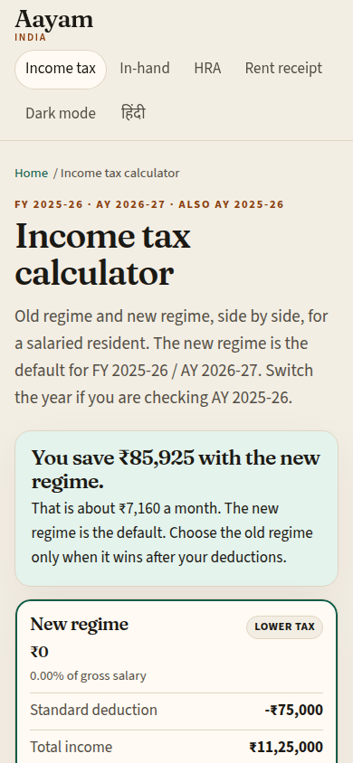
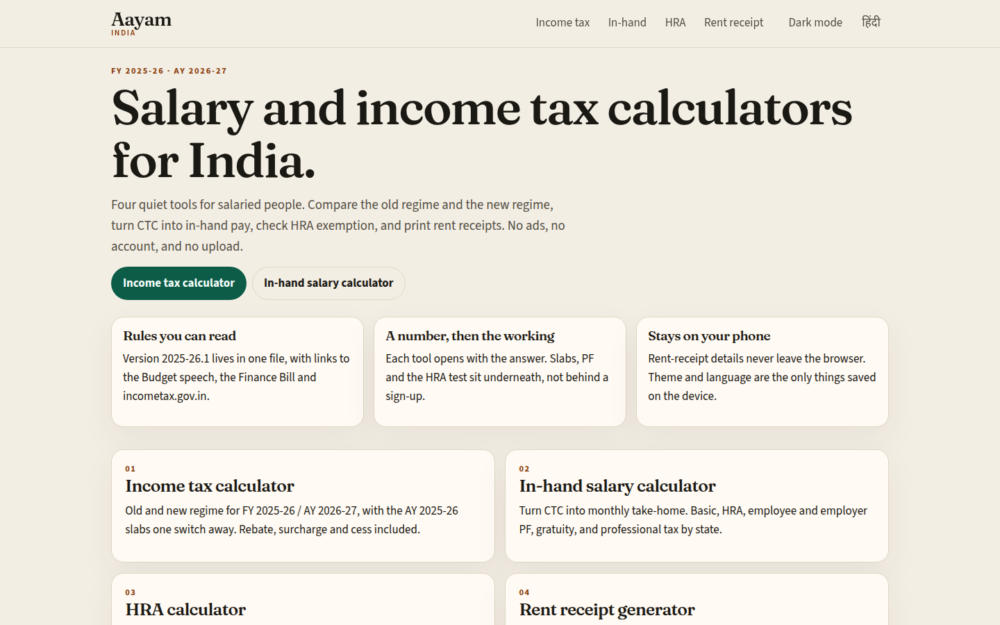
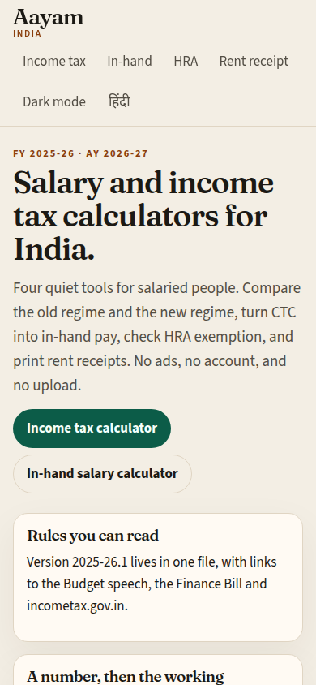
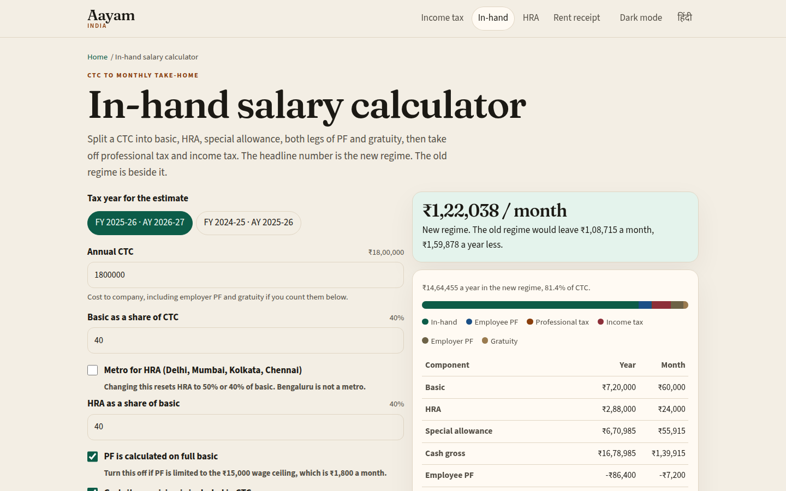
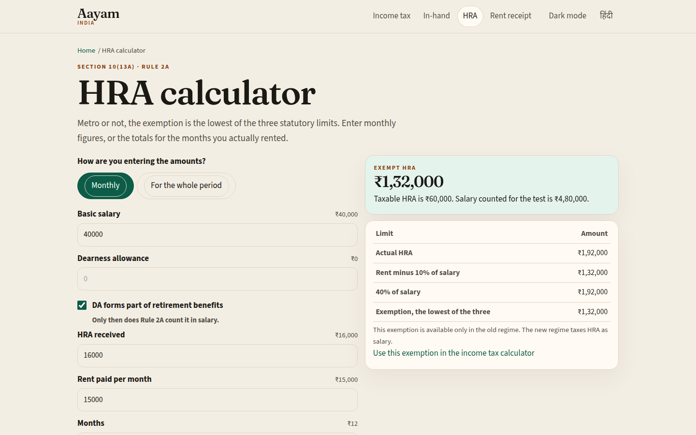
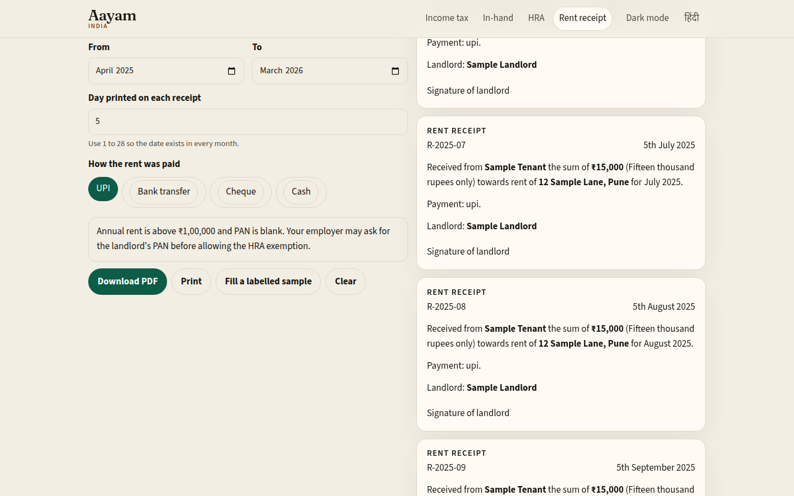
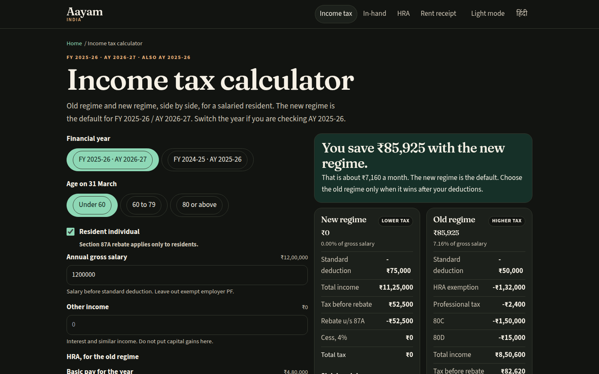

# Aayam

Salary and income-tax calculators for salaried people in India. Static site, no account, no upload.

- [Income tax calculator](docs/screenshots/tax-desktop.png) for FY 2025-26 / AY 2026-27, with FY 2024-25 / AY 2025-26 still available. Old and new regime side by side, including the section 87A rebate, surcharge and cess.
- [In-hand salary calculator](docs/screenshots/salary-desktop.png) from CTC: basic, HRA, employee and employer PF, gratuity, and professional tax by state.
- [HRA calculator](docs/screenshots/hra-desktop.png) for metro and non-metro cities.
- [Rent receipt generator](docs/screenshots/receipt-desktop.png). The PDF is built in the browser. Nothing is uploaded.

This is not the Income Tax Department and it does not file returns. Rules version `2025-26.1` is in [`lib/tax-rules.ts`](lib/tax-rules.ts), with links to the Budget speech, the Finance Bill and [incometax.gov.in](https://www.incometax.gov.in/).

## Screenshots

Desktop, income tax. The worked example saves ₹85,925 with the new regime.



The same calculator on a phone.



Home, in-hand salary, HRA, rent receipts, and dark mode.













## Interface

Pages are built with [Sutra UI](https://github.com/AkhilSingh2/sutra-ui) components and design tokens. The packages are not on npm. Built files live in [`vendor/sutra-ui/`](vendor/sutra-ui/README.md) and are installed with `file:` dependencies, so CI can run `npm ci` without cloning the design system.

App CSS uses the token variables (`--sutra-color-*`, `--sutra-font-*`, `--sutra-space-*`, `--sutra-radius-*`, `--sutra-shadow-*`, `--sutra-motion-*`). It does not name a palette or a typeface. Replacing the vendored `dist` folders and rebuilding picks up a new token build.

## Run it locally

Node 20 or newer.

```bash
npm ci
npm test
npm run dev
```

`npm run build` writes a static site to `out/`. Leave `NEXT_PUBLIC_BASE_PATH` unset for a local or Vercel deploy at the root of the domain.

## Tests

`npm test` covers slab edges for both years, the section 87A rebate and its marginal relief, the old-regime cliff at ₹5 lakh, surcharge including the 25% new-regime cap above ₹5 crore, HRA’s three limits, CTC arithmetic, state professional tax, and the rent-receipt PDF.

`npm run check:routes` loads the static export in a browser under `/india-salary-tax`. Build first with `NEXT_PUBLIC_BASE_PATH=/india-salary-tax`. It needs Chrome.

## Deploy

GitHub Actions:

- [`.github/workflows/ci.yml`](.github/workflows/ci.yml) runs tests, the type check, lint, and the production build.
- [`.github/workflows/pages.yml`](.github/workflows/pages.yml) builds with `NEXT_PUBLIC_BASE_PATH=/india-salary-tax` and deploys `out/` to GitHub Pages.

In the repository settings, set Pages to **GitHub Actions** once. The public URL is `https://akhilsingh2.github.io/india-salary-tax/`.

On Vercel, import the repo with no base path. Set `NEXT_PUBLIC_SITE_URL` to the Vercel domain so canonical URLs and the sitemap match. [`vercel.json`](vercel.json) adds a few security headers. There is no server.

## Search

Page titles, the Hindi FAQs, and what to write next are in [`docs/SEO.md`](docs/SEO.md).

## Privacy

Rent-receipt names, addresses and PAN stay in the browser. Theme and language are the only values written to local storage. The sample receipt uses the labels “Sample Tenant” and “Sample Landlord”.
